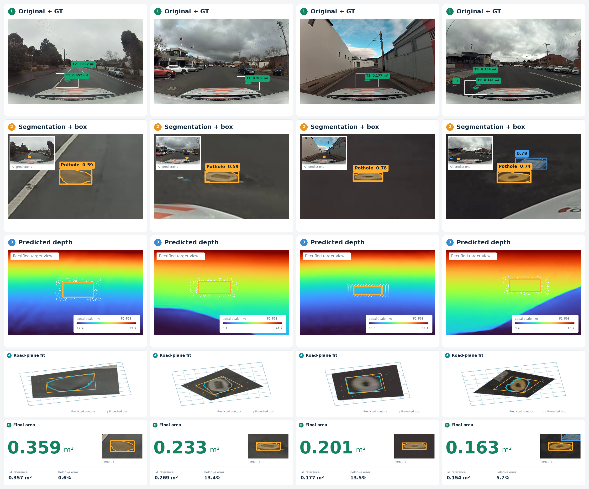
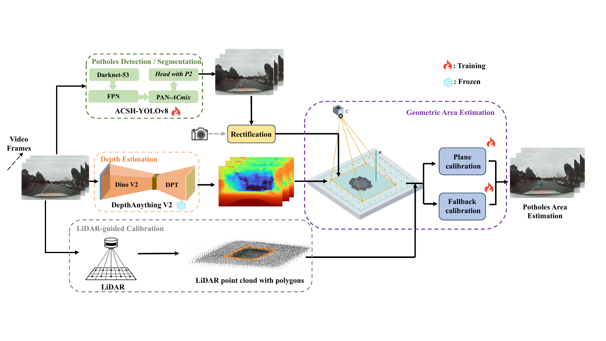

<h1 align="center">From Recognition to Measurement</h1>
<p align="center"><b>Pothole Area Estimation through Local Road Geometry</b></p>
<p align="center">Dehao Wang · Haohang Zhu · Bowen Xu · Yiwen Xu · Kaiqi Liu</p>

<p align="center">
  <a href="#quick-start"></a>
  <a href="https://github.com/Wonder-How/potholes_area/actions/workflows/ci.yml"></a>
  <a href="LICENSE"></a>
  <a href="README.zh-CN.md"></a>
</p>

<p align="center">
  <a href="#see-it-in-action">Demos</a> ·
  <a href="#how-it-works">Method</a> ·
  <a href="#quick-start">Quick start</a> ·
  <a href="#results-at-a-glance">Results</a> ·
  <a href="docs/implementation.md">Implementation</a>
</p>

Turn an RGB image into a pothole footprint estimate in **square meters**. ACSH recognizes potholes, frozen metric depth supplies scene geometry, and a local supporting-road plane connects image coordinates to calibrated area. Camera parameters and training-derived calibration remain fixed at inference.

This repository packages the code, frozen ACSH checkpoint, camera configuration and calibration accompanying our **2026 manuscript**. [Artifact provenance](docs/PROVENANCE.md) and [full results](docs/RESULTS.md) describe the experimental scope.

## See it in action

<p align="center">
  
</p>

Four curated, independent test images are shown side by side at display confidence 0.25; the quantitative area benchmark uses 0.05. Each column follows the same example through five processing stages to the **projected bounding-box footprint on the local road plane**.

## How it works

<p align="center">
  <a href="docs/assets/paper/structure_revised.pdf"></a>
  <br><sub>Original framework figure from the manuscript. Click for the PDF.</sub>
</p>

1. **Recognize.** A YOLOv8n-seg front end adds a supervised parallel P2 branch and ACmix at the mask-prototype input. Its directly predicted box feeds the adopted area path.
2. **Recover local geometry.** Rectify the camera image, estimate metric depth, and fit a road plane using support around the predicted box. Keep the original fallback when plane projection is unavailable.
3. **Measure.** Intersect box-boundary rays with the local plane, then apply frozen, route-specific log-OLS calibration learned from training references. The optional mask-area branch provides a comparison.

The core package also accepts existing boxes and rectified depth arrays, so geometry can run independently of the neural front end.

## Quick start

Python 3.10+; Python 3.11 was used for release verification.

```bash
git clone https://github.com/Wonder-How/potholes_area.git pothole-measurement
cd pothole-measurement
python -m venv .venv
source .venv/bin/activate
python -m pip install -e .

# CPU-only synthetic scene: verify geometry, JSON export and visualization.
pothole-measure demo --output outputs/demo
```

The demo creates a synthetic plane with a known footprint. It requires neither pretrained weights nor a dataset. See [implementation and input formats](docs/implementation.md) for geometry-only use and calibration.

### Run the included ACSH checkpoint

```bash
python -m pip install -e '.[models]'
sha256sum -c weights/SHA256SUMS

# Supply an original-resolution M2S image and its rectified metric-depth cache.
pothole-measure infer \
  --weights weights/acsh-segmentation.pt \
  --source path/to/image.png \
  --depth path/to/depth.npz \
  --camera configs/m2s-camera.json \
  --calibration configs/m2s-calibration.json \
  --conf 0.05 --device cpu \
  --output outputs/predictions
```

For live monocular depth inference, replace `--depth ...` with `--depth-model path/to/local-depth-model`. Use a local copy of `depth-anything/Depth-Anything-V2-Metric-Outdoor-Small-hf`. The loader reads local files; obtain the depth model separately from its publisher. `--source` accepts an image, an image directory or a video; video frames are processed independently.

The supplied camera file is for **1920 × 1208 M2S fisheye images**. A depth cache contains a 2D `depth` array in meters on the rectified grid and optionally the matching rectified `k` matrix. For your own camera or scene, supply its calibration and fit area coefficients on training references. The M2S coefficients are tied to the released geometry and depth model.

### Train ACSH

Provide a YOLO-format **segmentation** dataset YAML and local YOLOv8n-seg pretrained weights:

```bash
pothole-measure train \
  --data path/to/data.yaml \
  --weights path/to/yolov8n-seg.pt \
  --config configs/acsh-segmentation.json \
  --device 0 \
  --output outputs/training
```

The selected configuration retains the original seed-1130, 60-epoch, 768-pixel recipe. Dataset files and the depth model are obtained separately. Training this configuration alone does not recreate all manuscript ablations and evaluation cohorts.

## Results at a glance

**Controlled geometry — manual boxes, 257 calibration / 187 evaluation observations**

| Area estimator | MAE ↓ | MAPE ↓ | Within 50% error ↑ |
|:--|--:|--:|--:|
| Calibrated MBTP | 0.3386 m² | 57.02% | 66.31% |
| Calibrated rectified depth-XY | 0.3661 m² | 58.92% | 62.57% |
| **Local road plane + OLS** | **0.1983 m²** | **32.40%** | **86.10%** |

**End-to-end — predicted boxes, 75 images / 58 area references, frozen seed 1130**

| Recognition + area path | E2E within 20% ↑ | E2E within 50% ↑ | Matched MAE ↓ |
|:--|--:|--:|--:|
| YOLOv8n-seg + box | 17.24% | 36.21% | 0.0844 m² |
| **ACSH segmentation + box** | **24.14%** | **39.66%** | **0.0832 m²** |

End-to-end percentages count unmatched or invalid estimates as failures over all 58 references. Matched MAE conditions on each pipeline's valid matches; the adopted path has **29**. These are archived manuscript results; repository preparation did not rerun training or the complete benchmark.

The final controlled runtime study reports **243.63 → 154.02 ms/frame** (**1.58×**, 36.78% lower mean latency) on the same single-frame pipeline, including live depth. It covers 225 paired executions on an RTX 4090 D and checks 1,095 predicted-box records for identical numeric outputs. Hardware, timing boundaries, other baselines and study limitations are documented in [RESULTS.md](docs/RESULTS.md).

## Repository map

```text
├── src/pothole_measurement/  # Geometry, calibration, inference and training
├── configs/                 # Frozen ACSH recipe, M2S camera and area calibration
├── weights/                 # Released ACSH checkpoint and SHA-256 checksum
├── docs/assets/             # Static comparison, original paper figure and media records
├── scripts/make_demo_comparison.py
├── scripts/make_demo_gifs.py # Archived animation exports
├── tests/                   # Analytic geometry and training-only calibration checks
└── docs/
    ├── implementation.md    # CLI, formats and implementation details
    ├── RESULTS.md           # Metrics, denominators and timing scope
    ├── PROVENANCE.md        # Research-source mapping and frozen artifact identity
    └── THIRD_PARTY.md       # Upstream projects and licenses
```

## Acknowledgments and license

Built with [Ultralytics](https://github.com/ultralytics/ultralytics), [Depth Anything V2](https://github.com/DepthAnything/Depth-Anything-V2), [ACmix](https://github.com/LeapLabTHU/ACmix) and [M2S-RoAD](https://github.com/chinitaberrio/M2S-RoAD). Code is distributed under [AGPL-3.0](LICENSE), consistent with the Ultralytics-derived implementation. Dataset and upstream model terms are described in [THIRD_PARTY.md](docs/THIRD_PARTY.md).
