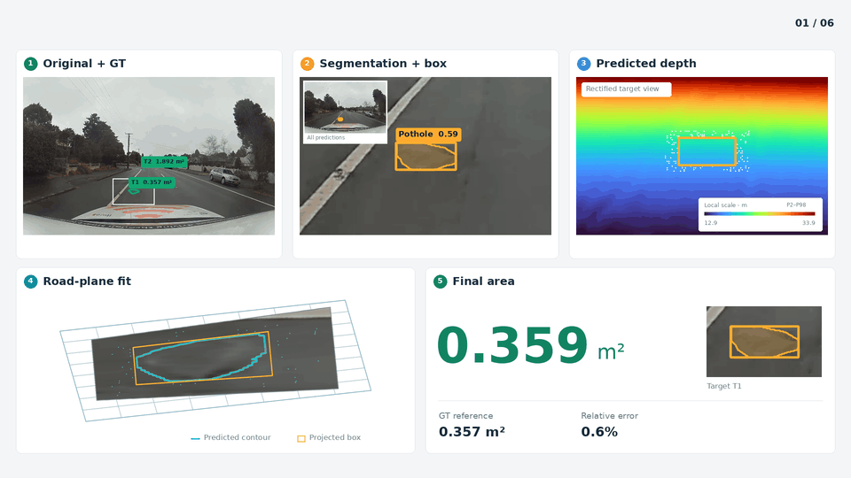

# 从识别到测量：基于局部路面几何的坑洼面积估计

[English](README.md) · [方法与接口](docs/implementation.md) · [实验结果](docs/RESULTS.md) · [代码与权重来源](docs/PROVENANCE.md)

从一张 RGB 图像出发，用 ACSH 识别坑洼，再结合冻结的单目公制深度、相机矫正、局部路面平面拟合与训练集标定，输出以 **m²** 为单位的面积估计。

本仓库整理了当前论文版本的代码、ACSH 模型权重、相机参数和冻结标定系数。论文标题为 *From Recognition to Measurement: Pothole Area Estimation through Local Road Geometry*，目前为 2026 年未发表稿件。

## 演示



演示来自此前视频中的精选独立测试图像，显示置信度为 0.25；定量面积实验使用 0.05。最终面积来自**预测框在局部路面上的投影足迹**。[完整 24 秒视频](docs/assets/from-image-to-area.mp4) · [媒体记录](docs/assets/media_manifest.json)。

## 方法

[](docs/assets/paper/structure_revised.pdf)

直接使用论文现有框架图，点击查看 PDF。

## 快速运行

需要 Python 3.10 或更高版本；发布验证使用 Python 3.11。

```bash
git clone https://github.com/Wonder-How/potholes_area.git pothole-measurement
cd pothole-measurement
python -m venv .venv
source .venv/bin/activate
python -m pip install -e .
pothole-measure demo --output outputs/demo
```

这条命令在 CPU 上生成已知面积的合成平面，检查几何计算、JSON 输出和可视化，无需下载权重或数据集。

安装神经网络依赖后，可使用仓库内的 ACSH 权重：

```bash
python -m pip install -e '.[models]'
sha256sum -c weights/SHA256SUMS

pothole-measure infer \
  --weights weights/acsh-segmentation.pt \
  --source path/to/image.png \
  --depth path/to/depth.npz \
  --camera configs/m2s-camera.json \
  --calibration configs/m2s-calibration.json \
  --conf 0.05 --device cpu \
  --output outputs/predictions
```

`depth.npz` 需要包含矫正图像网格上的二维公制深度 `depth`，可选对应的矫正内参 `k`。也可将 `--depth` 改为 `--depth-model path/to/local-depth-model`，读取本地 `Depth-Anything-V2-Metric-Outdoor-Small-hf` 模型，实时计算深度。深度模型需要单独获取。

配套相机文件对应 **1920 × 1208** 的 M2S 鱼眼图像。自己的相机和场景应提供对应内参，并在训练参考上拟合面积标定；输入格式、训练入口、纯几何用法见[实现说明](docs/implementation.md)。

## 实验口径

| 实验 | 当前稿件结果 |
|:--|:--|
| 人工框几何实验，257 条标定 / 187 条评估 | MAE **0.1983 m²**，MAPE **32.40%**，A50 **86.10%** |
| 端到端，75 张测试图 / 58 个面积参考 | A20 **24.14%**，A50 **39.66%** |
| 端到端的 29 个有效匹配 | 条件 MAE **0.0832 m²**，MdAPE **21.53%** |
| 最终受控运行时实验 | **243.63 → 154.02 ms/帧**，**1.58 倍**加速 |

端到端 A20/A50 的分母包含全部 58 个参考，未匹配或无效估计计为失败。匹配后的 MAE 只统计有效匹配，不能替代端到端准确率。运行时来自包含在线深度计算的单帧配对实验，与动图播放帧率无关。以上为论文归档结果，本次仓库整理没有重新训练或完整复跑实验。

完整基线、数据划分、硬件与计时范围、已知局限见[实验结果文档](docs/RESULTS.md)。

## 引用与许可

作者：Dehao Wang、Haohang Zhu、Bowen Xu、Yiwen Xu、Kaiqi Liu。引用格式见 [README](README.md#citation) 与 [CITATION.cff](CITATION.cff)。

代码使用 [AGPL-3.0](LICENSE)，保留上游依赖的许可信息。数据集和深度模型由原发布方单独提供，详见[第三方说明](docs/THIRD_PARTY.md)。
